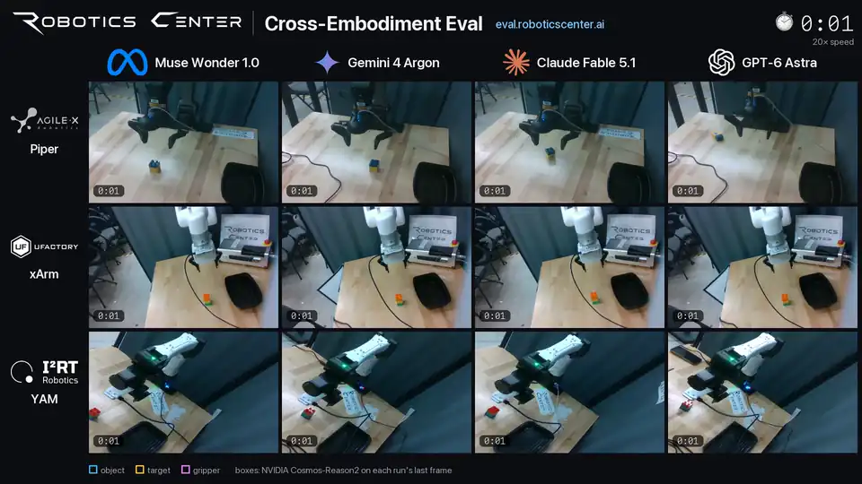
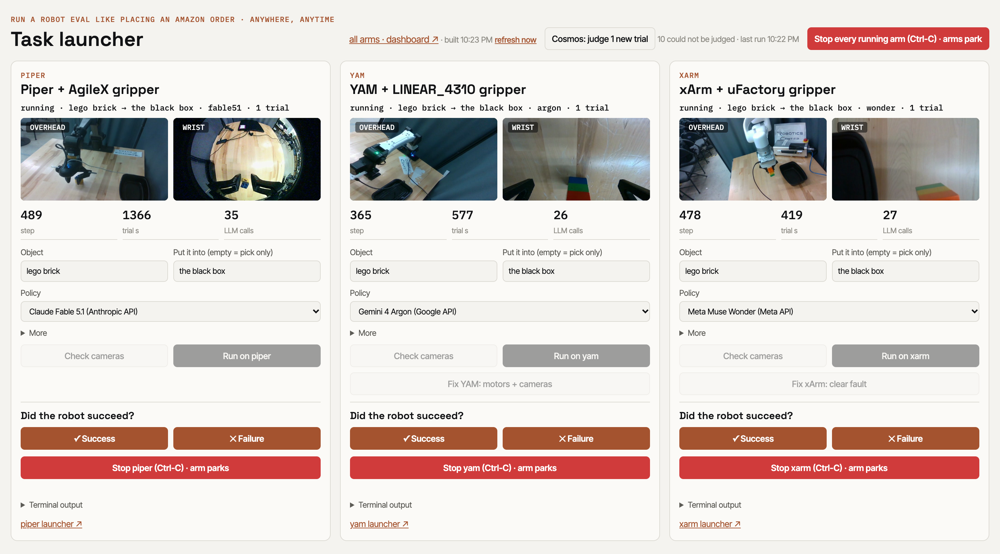
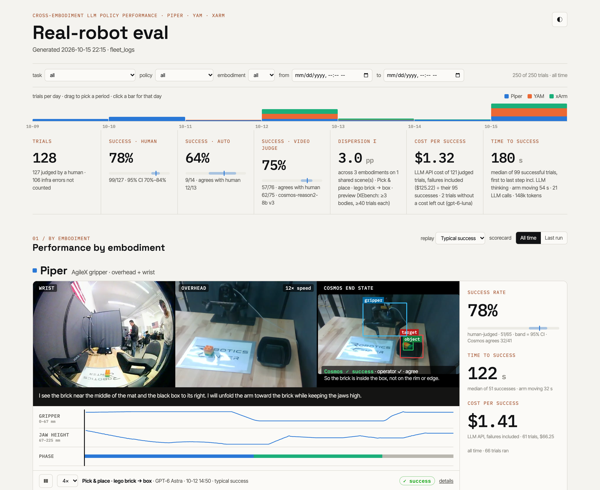
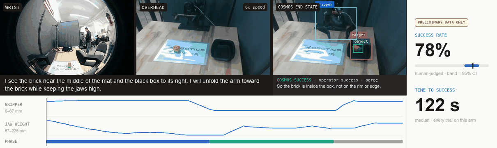
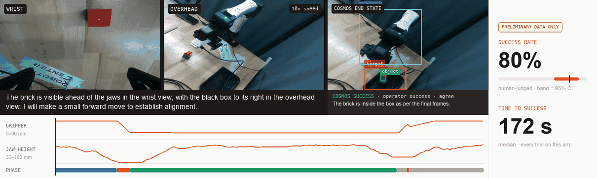
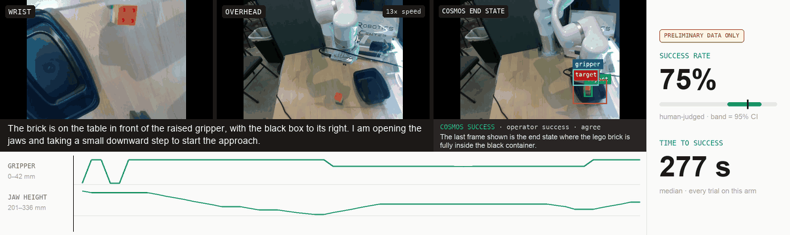
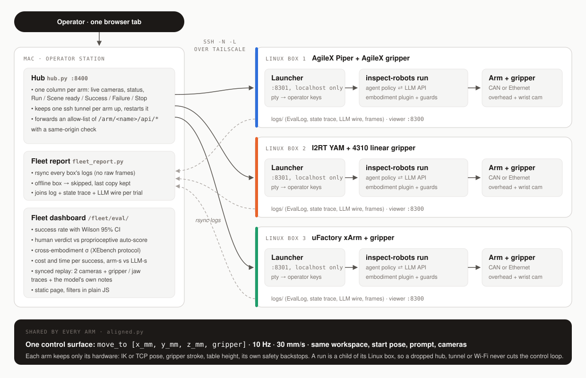

# Real-Robot Cross-Embodiment Eval: Same Brain, Different Bodies

**TL;DR** Same LLM agent, same tasks, three different robot arms. One hub drives an AgileX Piper, an I2RT YAM
and a uFactory xArm through one shared control interface, and every real-robot trial lands in one dashboard.

**3 arms · 4 LLMs · 250 real-robot trials**

## One hub, three arms running at once

One page on the Mac, one column per arm: live cameras, progress, and the operator's controls.

## Real-robot eval dashboard

Every trial from every arm, filterable, with synced video replay and a Cosmos Reason video judge next to the
operator's verdict: **$1.32 per success**, **σ = 3.0 pp** across the three arms, and the video judge agrees with the
operator on **62 of 75** trials.

<!-- TODO: link the live dashboard here once it is hosted -->

## Three embodiments, same task

*Put the lego brick into the black box*, driven by GPT-6 Astra. Each clip shows both cameras and the Cosmos end
state: the last frame with the video model's boxes and its verdict next to the operator's. Below: what the LLM wrote
at that step, then the gripper and jaw-height traces following the video. The score card covers every trial on that
arm.

### AgileX Piper · AgileX gripper

### I2RT YAM · 4310 linear gripper

### uFactory xArm · uFactory gripper

## How it works

## More to come

This harness runs the arm side of **[XEbench](https://dexterity.roboticscenter.ai/benchmark)**, Robotics
Center's open cross-embodiment benchmark: freeze one policy, swap the body, see what breaks. Next:

- **Dexterous hands**: multi-finger hands on XEbench's hand tasks (key presses, piano sequences)
- **Two hands**: bimanual tasks that need both arms to cooperate
- **More models**: beyond LLMs to VLAs (GR00T, π0) and world action models (WAMs), on the same arms and protocol
- **A human baseline**: teleoperated runs on the same robot, for human-relative throughput
- **A sharper automatic judge**: NVIDIA Cosmos Reason already grades every trial against the human verdicts; next, failure
  modes and event timing from the same model

---

**Note.** All results are preliminary pilot data, shown for demonstration purposes only; they are not official
Robotics Center or XEbench results. The robots, lab, footage and underlying data belong to
[Robotics Center](https://dexterity.roboticscenter.ai/benchmark); all rights reserved.
